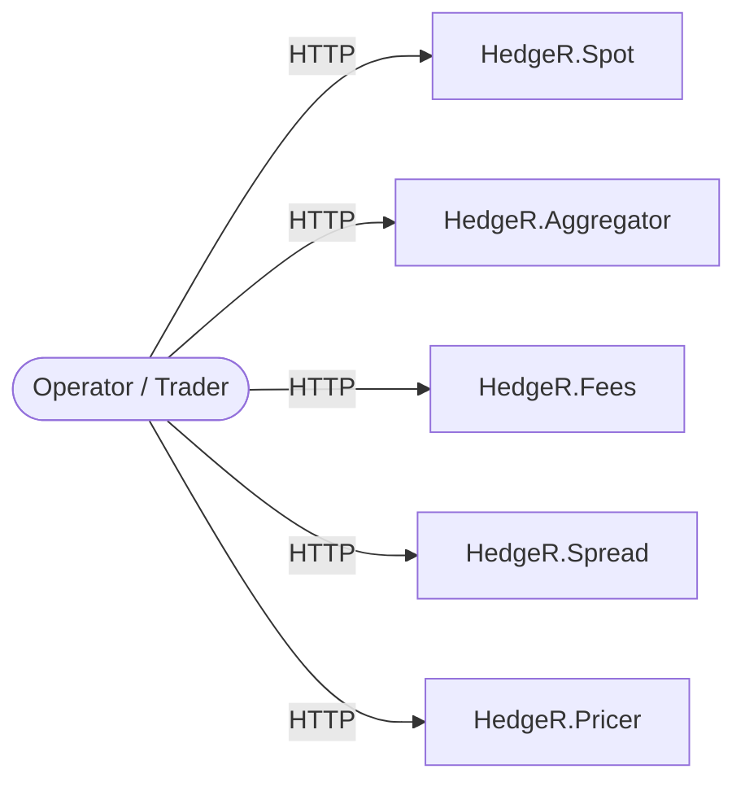
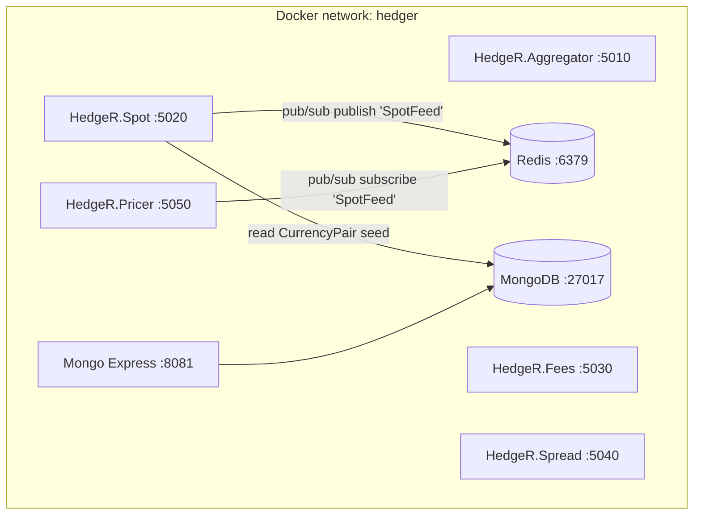
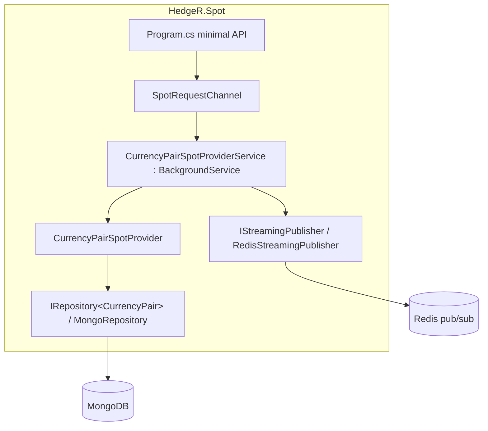
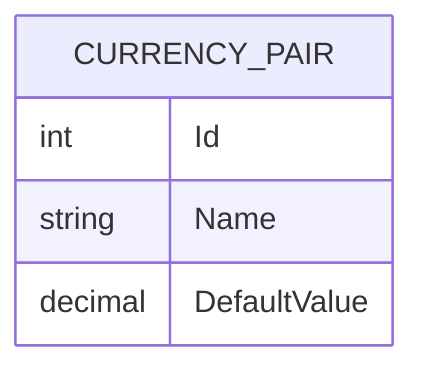
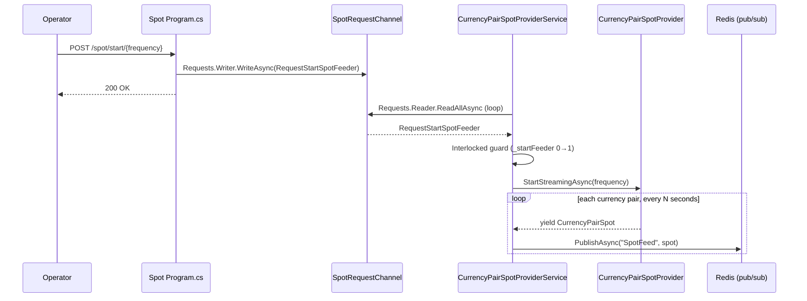
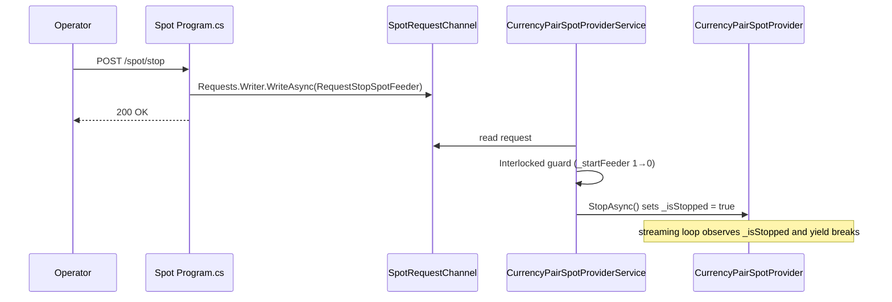
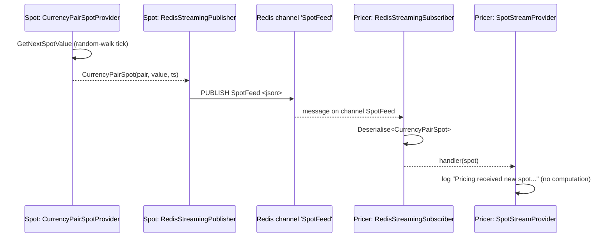
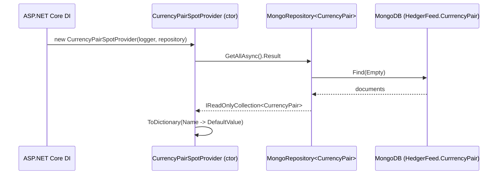

# HedgeR — Technical Documentation
_Generated 2026-07-19. Based on branch `master`, commit `87e6822`._

## 1. Overview
HedgeR is a .NET 6 microservices system, structured as one solution with five independently deployable ASP.NET Core services (`HedgeR.Aggregator`, `HedgeR.Feeds/Spot`, `HedgeR.Feeds/Fees`, `HedgeR.Feeds/Spread`, `HedgeR.Pricer`) plus a shared class library (`HedgeR.Shared`). Its stated purpose (`README.md:2`) is pricing financial products; as implemented today, only one vertical slice is functional end-to-end: `Spot` generates synthetic currency-pair prices and streams them over Redis pub/sub to `Pricer`, which currently only logs what it receives. Everything else is deployment/DI scaffolding for future work.

## 2. Architecture (C4)

### 2.1 Context (C4 L1)
An operator drives the system over HTTP (directly or via each service's Swagger UI). There is no confirmed external market-data provider — the one price source that exists (`CurrencyPairSpotProvider`) synthesizes values locally rather than consuming an outside feed (see §9, open question).

### 2.2 Containers (C4 L2)
Five ASP.NET Core Web SDK services (net6.0, Kestrel, `ENV ASPNETCORE_URLS http://*:80` in each `Dockerfile`), a Redis instance (pub/sub transport), a MongoDB instance (reference data), and Mongo Express (DB admin UI, `compose/infrastructure.yml:25-35` — no application code talks to it). Services share code via a `ProjectReference` to `HedgeR.Shared`, not via a runtime dependency.

Ports and container names: `compose/services.yml:1-65`. `depends_on: hedger-aggregator` is declared for `spread` (`compose/services.yml:49-50`) but no code in `HedgeR.Spread` calls `HedgeR.Aggregator` — a compose-level ordering hint with no corresponding implementation (see §9).

### 2.3 Components — HedgeR.Spot (the one fully-wired service)

Citations: `src/HedgeR.Feeds/Spot/Program.cs:1-51`, `Requests/SpotRequestChannel.cs`, `BackgroundServices/CurrencyPairSpotProviderService.cs`, `SpotProviders/CurrencyPairSpotProvider.cs`.

## 3. Component reference

| Component | Responsibility | Key symbols | Depends on |
|---|---|---|---|
| `HedgeR.Aggregator` | Placeholder Web API; no domain logic wired yet | `Program.cs:1-6` (single `MapGet("/")`) | `HedgeR.Shared` (referenced, unused) |
| `HedgeR.Feeds/Fees` | Placeholder Web API; no domain logic wired yet | `Program.cs:1-6` | `HedgeR.Shared` (referenced, unused) |
| `HedgeR.Feeds/Spread` | Placeholder Web API; no domain logic wired yet | `Program.cs:1-6` | `HedgeR.Shared` (referenced, unused) |
| `HedgeR.Feeds/Spot` | Generates synthetic currency-pair spot prices on demand and publishes them | `Program.cs`, `CurrencyPairSpotProviderService`, `CurrencyPairSpotProvider`, `SpotRequestChannel` | Mongo (seed data), Redis (publish), `HedgeR.Shared` |
| `HedgeR.Pricer` | Subscribes to the spot feed; currently only logs received ticks — computes no price | `Program.cs:7-13`, `StreamProviders/SpotStreamProvider.cs` | Redis (subscribe), `HedgeR.Shared` |
| `HedgeR.Shared` | Cross-cutting infrastructure: Mongo repository, Redis pub/sub streaming, JSON serialization, Swagger wiring | see §6 | `MongoDB.Driver`, `StackExchange.Redis`, `Swashbuckle.AspNetCore` (`src/HedgeR.Shared/HedgeR.Shared.csproj:9-14`) |

**Naming-lies found (highest-value findings):**
- `HedgeR.Pricer` — the service named "Pricer" contains no pricing computation anywhere in the repo; `SpotStreamProvider.ExecuteAsync` (`src/HedgeR.Pricer/StreamProviders/SpotStreamProvider.cs:16-22`) only logs the received spot.
- `HedgeR.Shared.Redis.Streaming.RedisStreamingPublisher`/`RedisStreamingSubscriber` (`src/HedgeR.Shared/Redis/Streaming/RedisStreamingPublisher.cs`, `RedisStreamingSubscriber.cs`) are named "Streaming" but implement Redis **pub/sub** (`IConnectionMultiplexer.GetSubscriber().PublishAsync`/`SubscribeAsync`), not the Redis Streams data structure (`XADD`/`XREADGROUP`). No message durability, consumer groups, or replay exist despite the naming.
- `RedisExtenisons.cs` and `RedisOptions.cs` (`src/HedgeR.Shared/Redis/RedisExtenisons.cs:1-9`, `RedisOptions.cs:1-3`) live in namespace `HedgeR.Shared.Swagger` — an apparent copy/paste artifact unrelated to Swagger.
- `HedgeR.Aggregator`, `HedgeR.Fees`, `HedgeR.Spread` do not aggregate, calculate fees, or compute spreads — each `Program.cs` is a 6-line stub returning a greeting string.

## 4. Data model
One entity, one collection, one database. No relationships.

- Entity: `CurrencyPair` (`src/HedgeR.Feeds/Spot/Entities/CurrencyPair.cs:5-13`), implements marker `IEntity` (`src/HedgeR.Shared/Mongo/IEntity.cs`).
- Persistence: MongoDB, database `HedgerFeed`, collection **`CurrrencyPair`** (triple-r typo, `src/HedgeR.Feeds/Spot/Program.cs:51`).
- Access: generic `MongoRepository<T>` (`src/HedgeR.Shared/Mongo/MongoRepository.cs`) implementing `IRepository<T>` (CRUD by `Id` or LINQ filter). Only `HedgeR.Spot` registers a repository (`AddMongoRepository<CurrencyPair>`, `Program.cs:50-51`); no other service touches Mongo.
- `CurrencyPairSpot` (`src/HedgeR.Feeds/Spot/Models/CurrencyPairSpot.cs`, duplicated independently in `src/HedgeR.Pricer/Models/CurrencyPairSpot.cs`) is a transient DTO (`record CurrencyPair, decimal Value, long Timestamp`), never persisted — it is the wire payload for the Redis channel, not a stored entity. The two copies are structurally identical but are separate types maintained in each project (no shared contract).

## 5. Key flows (sequence diagrams)

### 5.1 Start the spot feeder
`POST /spot/start/{frequency}` (`Program.cs:19-25`) enqueues a request rather than acting synchronously; the actual generation loop runs in a `BackgroundService` reading off an unbounded `System.Threading.Channels.Channel<IRequestSpot>` (`SpotRequestChannel.cs:7`).

Citations: `Program.cs:19-25`, `CurrencyPairSpotProviderService.cs:22-62`, `CurrencyPairSpotProvider.cs:30-63`.

Note the request/response is decoupled from execution: the HTTP call returns `200 OK` as soon as the command is enqueued, before the feeder actually starts (fire-and-forget from the caller's perspective).

### 5.2 Stop the spot feeder

Citations: `Program.cs:27-33`, `CurrencyPairSpotProviderService.cs:35-46`, `CurrencyPairSpotProvider.cs:65-69`.

### 5.3 Spot tick generation and delivery to Pricer

Citations: `CurrencyPairSpotProvider.cs:71-76`, `RedisStreamingPublisher.cs:18-23`, `RedisStreamingSubscriber.cs:25-38`, `SpotStreamProvider.cs:16-22`.

Delivery semantics: Redis pub/sub is fire-and-forget — if `Pricer` is offline or the subscription hasn't been (re)established, published ticks are **not** queued or replayed; they are lost. No reconnection/heartbeat logic exists in `RedisStreamingSubscriber`.

### 5.4 Currency pair seed load (service startup)

Citations: `CurrencyPairSpotProvider.cs:14-28`. The seed dictionary is built once, in the constructor, using a **blocking synchronous `.Result`** on an async call (`GetCurencyPairs`, line 25) — a risk under ASP.NET Core's synchronization context (see §6). Because it only runs at construction, any change to the `CurrrencyPair` collection in Mongo requires a service restart to take effect — it is not re-read per request.

## 6. Cross-cutting concerns

- **Config**: Each service reads `appsettings.json` + `appsettings.{ASPNETCORE_ENVIRONMENT}.json`. Every `Dockerfile` sets `ASPNETCORE_ENVIRONMENT=docker` (e.g. `src/HedgeR.Feeds/Spot/Dockerfile:10`), but no `appsettings.docker.json` exists anywhere in the repo — so containers run on the base `appsettings.json` only, and the checked-in `appsettings.Development.json` files never apply in Docker. Switching between local and containerized Mongo/Redis endpoints is done by manually commenting/uncommenting connection-string lines in `appsettings.json` (`src/HedgeR.Feeds/Spot/appsettings.json:10-16`), not via environment-based config layering.
- **Dead config**: `compose/services.yml:26` sets `MongoDB__Host: mongo` for the `spot` container, but `MongoDbSettings` (`src/HedgeR.Shared/Mongo/MongoDbSettings.cs`) only has `ConnectionString`/`DataBaseName`, bound from section `MongoDbSettings` (`MongoExtensions.cs:20`, `nameof(MongoDbSettings)`). The env var's key path (`MongoDB:Host`) matches neither the section name nor a property — it has no effect at runtime.
- **DI registration order matters**: both `HedgeR.Spot` and `HedgeR.Pricer` call `AddStreaming()` (registers no-op `DefaultStreamingPublisher`/`DefaultStreamingSubscriber`, `StreamingExtension.cs`) *before* `AddRedisStreaming()` (registers the Redis-backed implementations, `RedisStreamingExtension.cs`). ASP.NET Core DI resolves the **last** registration for a singleton interface, so the Redis implementation wins in both services today — but this is order-dependent, not type-safe; swapping the two calls would silently make streaming a no-op.
- **Concurrency**: `CurrencyPairSpotProvider` constructor blocks on `.Result` (`CurrencyPairSpotProvider.cs:25`) — a sync-over-async call. `CurrencyPairSpotProviderService` guards start/stop with `Interlocked.Exchange` on a plain `int` flag (`CurrencyPairSpotProviderService.cs:39,52`), not a lock, so it is safe for the single-writer channel-consumer pattern used here but would not generalize to concurrent callers.
- **Serialization**: single shared JSON serializer (`DefaultSerializer`, camelCase, case-insensitive) used for all Redis payloads (`Serializer/DefaultSerializer.cs`).
- **API documentation**: Swagger/OpenAPI (`Swashbuckle.AspNetCore`) is wired only in `HedgeR.Spot` and `HedgeR.Pricer` (`SwaggerExtensions.cs`, called from their `Program.cs`); `Aggregator`, `Fees`, and `Spread` do not call `AddSwagger()`/`UseCustomSwagger()` despite referencing `HedgeR.Shared`.
- **Observability**: `ILogger<T>` (structured console logging via ASP.NET Core defaults) is the only observability mechanism found. No metrics or tracing libraries are referenced anywhere in the solution.
- **Resilience**: none implemented. `RedisExtenisons.cs:16` has an explicit `//TODO : Add retry policy to reconnect redis if it's down`. No retries, timeouts, or circuit breakers exist for Mongo or Redis calls.

## 7. Build, test & run
- **Build**: `dotnet build HedgeR.sln` (targets `net6.0` throughout, `HedgeR.sln:1-13`).
- **Tests**: no test project exists anywhere in the repository (confirmed by file listing — no `*.Tests.csproj` or `xunit`/`nunit` references in any `.csproj`).
- **Run — Docker (documented path)**: `start.bat` runs `docker compose -f compose\infrastructure.yml up -d` (Redis, Mongo, Mongo Express) then `docker compose -f compose\services.yml up -d` (the five app services); `stop.bat` tears both down (`README.md:6`, `start.bat`, `stop.bat`). `compose/services.yml` requires the `hedger` network to already exist (`external: true`, `services.yml:63-65`) — created implicitly by `infrastructure.yml`, so infra must start first.
- **Run — process manager alternative**: `pm2.yml` defines four `dotnet run` targets (aggregator, fees, spot, spread) for local/non-Docker process management; it omits `HedgeR.Pricer`, which is unregistered in `pm2.yml` (see §9).
- **Ports**: Aggregator 5010, Spot 5020, Fees 5030, Spread 5040, Pricer 5050 (`compose/services.yml`), all mapped to container port 80 internally.
- **Env vars**: `ASPNETCORE_ENVIRONMENT` (set to `docker` per Dockerfile; `Development` per `launchSettings.json` locally), `ASPNETCORE_URLS`.

## 8. Architecture Decision Records (inferred)

### ADR-1: Microservices as separate ASP.NET Core Minimal API projects sharing a common library
- **Status:** Inferred from code.
- **Decision:** Each pricing domain (`Aggregator`, `Spot`, `Fees`, `Spread`, `Pricer`) is its own deployable ASP.NET Core Web SDK project; cross-cutting infrastructure (Mongo, Redis, serialization, Swagger) lives in `HedgeR.Shared` and is pulled in via `ProjectReference`.
- **Evidence:** `HedgeR.sln:1-13`, every `*.csproj` referencing `HedgeR.Shared.csproj`.
- **Forces (inferred):** independent deployability/scaling per domain; avoid duplicating infra glue code.
- **Consequences:** each service currently duplicates its own copy of shared-shaped DTOs (`CurrencyPairSpot` exists twice, see §4) rather than sharing a contracts package — cross-service payload changes require manual sync.
- **Confidence:** High.

### ADR-2: Redis pub/sub as the inter-service real-time transport
- **Status:** Inferred from code.
- **Decision:** Real-time spot delivery uses Redis's pub/sub `PUBLISH`/`SUBSCRIBE` primitives via `StackExchange.Redis`'s `ISubscriber`, not Redis Streams, a message broker, or gRPC streaming.
- **Evidence:** `RedisStreamingPublisher.cs:18-23`, `RedisStreamingSubscriber.cs:25-38`.
- **Forces (inferred):** simplicity, low setup cost, Redis already present for other purposes.
- **Consequences:** no message durability/replay/consumer-group semantics; a disconnected or restarting `Pricer` silently misses ticks published while it was down. The "Streaming" naming implies durability that is not actually there (see naming-lies, §3).
- **Confidence:** High.

### ADR-3: MongoDB for reference/configuration data, not transactional data
- **Status:** Inferred from code.
- **Decision:** MongoDB stores the currency-pair catalog (name + seed default value) that `Spot` reads once at startup; it is not used for time-series or transactional state.
- **Evidence:** `CurrencyPair.cs`, `MongoRepository.cs`, `Program.cs:50-51` (only registration site in the whole solution).
- **Consequences:** updates to the currency-pair catalog require a service restart (§5.4).
- **Confidence:** High.

### ADR-4: In-process command queue (`System.Threading.Channels`) to decouple HTTP from the background streaming loop
- **Status:** Inferred from code.
- **Decision:** `Spot`'s start/stop HTTP endpoints don't call the streaming provider directly; they enqueue a command onto an unbounded channel consumed by a single `BackgroundService`.
- **Evidence:** `SpotRequestChannel.cs`, `CurrencyPairSpotProviderService.cs:22-33`.
- **Forces (inferred):** keep the long-running streaming loop off the ASP.NET Core request thread; single-writer control over the loop's start/stop state.
- **Consequences:** start/stop is asynchronous relative to the HTTP response — `200 OK` confirms enqueue, not that streaming actually started/stopped.
- **Confidence:** Medium (plausible single reason; could also be incidental to how `BackgroundService` examples are typically written).

### ADR-5: Shared wire-payload DTOs live in `HedgeR.Shared`, not duplicated per-service
- **Status:** Decided (`spread-calculation` change).
- **Decision:** New cross-service wire payloads (e.g. `CurrencyPairSpread`, the bid/ask tick broadcast on the new `SpreadFeed` channel) are defined once in `HedgeR.Shared` and referenced by every service that needs them, rather than each service maintaining its own independent copy.
- **Evidence:** `kido/changes/spread-calculation/design.md` §1.
- **Forces:** ADR-1's consequence — `CurrencyPairSpot` is duplicated independently in `HedgeR.Spot` and `HedgeR.Pricer` with no shared contract — was flagged as tech debt (§3, "naming-lies" and §8 ADR-1). Every service already has a `ProjectReference` to `HedgeR.Shared`, so sharing a DTO type costs nothing extra to wire up.
- **Consequences:** Going forward, new cross-service payloads should default to living in `HedgeR.Shared` unless there's a specific reason to diverge per-service. The existing `CurrencyPairSpot` duplication is *not* retroactively fixed by this ADR — it remains as-is unless a future change addresses it directly.
- **Confidence:** High (explicit decision, not inferred).

## 9. Confidence & open questions

- **No pricing logic exists.** `HedgeR.Pricer` only logs received spot ticks; there is no code anywhere that computes a price, applies a spread, or applies a fee. Whether `Aggregator`/`Fees`/`Spread`/`Pricer` are meant to combine into a priced output is unverifiable from the current source — **Low confidence**, open question.
- **No external market-data source.** `CurrencyPairSpotProvider` generates prices via a local random walk seeded from Mongo defaults (`GetNextSpotValue`, `CurrencyPairSpotProvider.cs:71-76`); nothing in the repo connects to an external FX/market-data provider. Unclear if this is a permanent test-data generator or a placeholder pending real integration — **Low confidence**.
- **`compose/services.yml:49-50`** declares `spread depends_on hedger-aggregator` with no corresponding HTTP/messaging call in either service's code — intended future coupling, not yet built. **Medium confidence** this reflects planned architecture (the name and dependency direction are suggestive) but it is unconfirmed.
- **`pm2.yml`** omits `HedgeR.Pricer` from its four managed apps — unclear whether intentional (e.g. Pricer always run via Docker) or an oversight. **Low confidence**.
- **`DockerDefaultTargetOS>Windows`** is set in `HedgeR.Pricer.csproj:7` but `src/HedgeR.Pricer/Dockerfile` is a standard Linux-based `mcr.microsoft.com/dotnet/*` image — the property appears to be unused Visual-Studio scaffolding, not a real Windows-container build path. **Medium confidence** it's inert.
- **Mongo Express** (`compose/infrastructure.yml:25-35`) is deployed but no application code or documented workflow references it beyond manual DB browsing — assumed to be a developer convenience tool.
- No automated tests exist to serve as an executable spec, so all business-rule statements in the functional doc are derived solely from reading implementation code — flagged per rule, not blanket-assumed.
